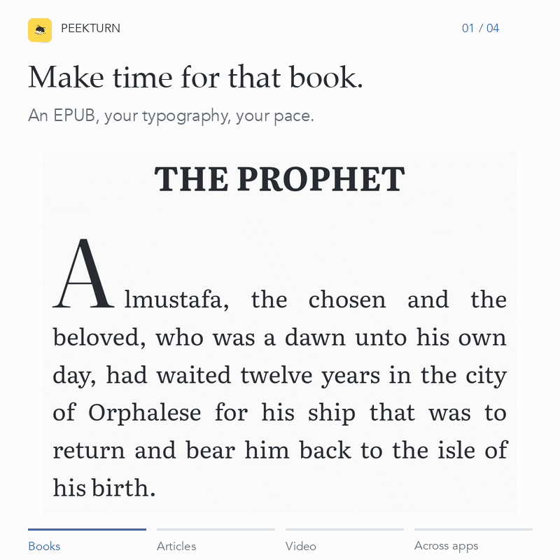

# Peekturn

### A bigger world, one word closer.

Open the book you have been putting off. Save an article worth a closer read. Watch a video that makes you curious. Peekturn keeps word meanings beside the content, so you can spend less time switching tools and more time understanding.

An Android reading and video app for people who know some English and want to learn from real content. **Read books, import articles and follow video captions with help in context. Take floating word lookup into other apps, too.**

**[Download the Android APK](https://github.com/Wake-C/peekturn/releases/latest)** · Android 8.0+ · [简体中文](README.md)

<picture>
  <source media="(prefers-reduced-motion: reduce)" srcset="assets/video/peekturn-intro-cover.jpg">
  <source type="image/webp" srcset="assets/video/peekturn-intro.webp">
  
</picture>

Recorded in the Android emulator with Peekturn's Classic White theme. [Full-size recording (MP4)](assets/video/peekturn-intro.mp4) · [GIF](assets/video/peekturn-intro.gif) · [Still image](assets/video/peekturn-intro-cover.jpg)

## A book, at your own pace

Import an EPUB or open the included *The Prophet* by Kahlil Gibran. Choose your font, text size, spacing and theme. Your reading position is saved. Start narration from the current sentence, change the speed or keep listening with the screen locked.

## Understand the sentence without leaving the page

Select a word or phrase to see meanings, context, examples and pronunciation beside the book. Close the explanation and continue the passage. The offline dictionary needs no setup. AI context explanations use your own configured provider and can be wrong.

## Give a good article a place on your shelf

Paste an article link or share it from another app. Open the full text in the import browser, then import it into the reader. Use the same typography, word explanations and narration as your books, and return to where you left off.

## Stay with the video, catch the words

Bring a public YouTube link. Follow the captions, tap an unfamiliar word, then replay the sentence and keep watching. Switch to audio only when you do not need the picture. Completed audio and video downloads, with available captions, can play offline.

## Take understanding with you

Reading in another app? **Drag Peekturn's floating lookup onto an English word.** It captures the screen when you release, recognizes the word on your phone, and opens the explanation over the page you were reading. No copying a sentence into another app.

Use the offline dictionary straight away, or connect your own AI service for context explanations. Screen-sharing permission is required; protected screens and apps that hide overlays may not work.

## Open something worth reading

1. **Install and open Peekturn.** Start with the included *The Prophet* by Kahlil Gibran, or import your own EPUB or article.
2. **Try a passage you want to understand.** Select an unfamiliar word to look it up, or start narration from the current sentence. For video, paste a YouTube video or playlist link in Video, or share it from another app. Each playlist has one entry in Video. Tap Episodes in the player to switch. Open the playlist again to return to your last episode.
3. **Add AI when you want context explanations.** Enter your own model service, model name and API key in Settings. Your provider may charge for requests, and explanations can be wrong.

Look up words in other apps

Enable floating lookup in Settings or add Lookup to Android Quick Settings. Drag the floating icon onto an English word in another app for an explanation or offline dictionary entry. When the icon is docked at the edge, tap once to expand it before dragging.

Overlay permission is required. Android also asks you to confirm screen sharing each time you start it. Stop from Quick Settings, the icon's Stop control or the notification. Protected screens may be unreadable.

Import web articles

Common Substack, WordPress, Ghost and static blog layouts are supported, including custom domains. X, Anthropic, OpenAI and other pages use the general article extractor. If you see only a paid preview, sign in or open the full article you have access to inside the import browser before importing.

## Your content and privacy

- Books, captions, reading and viewing positions, and learning statistics stay on your device. API keys are encrypted on the device.
- AI explanations send the selected text and a short surrounding context to your configured service. Online pronunciation and narration send text to the relevant speech service.
- Cross-app lookup is off by default. It captures the screen only when you release the icon and recognizes text on the device. Screen images and recognized text are not saved in the explanation cache.
- Video and caption availability depends on the source. Temporary buffering is not an offline download. Save only content you have permission to download. Subtitle grouping does not correct transcription errors.

In the recording: [The Prophet](https://www.gutenberg.org/ebooks/58585) by Kahlil Gibran, [Why Is the Sky Blue?](https://spaceplace.nasa.gov/blue-sky/en/) from NASA Space Place, and *The Drug To Master Reality* by [Kurzgesagt - In a Nutshell](https://www.youtube.com/@kurzgesagt). The cross-app lookup runs over the same NASA article in Chrome.

---

[Third-party notices](THIRD_PARTY_NOTICES.md) · [Source license](LICENSE) · [Development and delivery](agent-doc/essential/DELIVERY.md)
