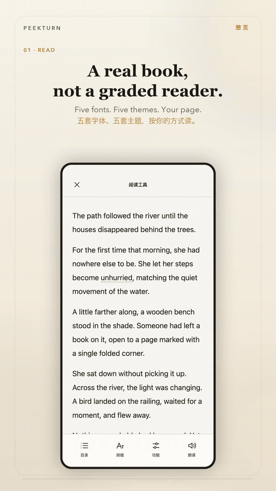

# Peekturn

Read English books and watch English videos, with help where you get stuck.

**[Download the Android APK](https://github.com/Wake-C/peekturn/releases/latest)** · [简体中文](README.zh-CN.md) · Android 8.0+

## Who it is for

Peekturn is for people who know some English and want to learn through real content. New words and long sentences interrupt your reading. Speech moves too fast, or you need to hear a line again.

Switching between a dictionary, translator and player can make you lose your place. Peekturn keeps word lookup, context explanations and pronunciation beside the book or subtitles, so you can get help and return to the content.

## Core features

- **Books and articles**: import EPUBs, or save web articles through a link or Android sharing. Keep your reading position.
- **Words in context**: select a word or phrase for dictionary meanings, an explanation of its use in the sentence, examples and pronunciation.
- **Read and listen**: start continuous narration from the current sentence, move between sentences, change speed and listen with the screen locked.
- **Video and audio**: import public YouTube links, follow captions, look up words and replay subtitle groups. Switch to audio only when you do not need the picture, or download audio/video and available captions for offline playback.
- **Reading preferences**: choose a font, one of four text sizes, three spacing levels and five themes. Reading and viewing positions are saved.

## Design goal

The book or video stays central. Help should be brief, useful and easy to leave. Peekturn aims to reduce interruptions so you can meet words and sentences in context, finish a book or video, and do more than collect definitions.

## Get started

1. Install the APK. Start with the included *The Prophet* by Kahlil Gibran, or import your own EPUB or article.
2. Paste a YouTube link in Video, or share it from another app.
3. The offline dictionary works without setup. For AI context explanations, add your own model service, model name and API key in Settings. Your provider may charge for requests.

## Privacy and limits

Books, captions, positions and learning statistics stay on your device. AI explanations send the selected text and a short surrounding context to your configured service. Online pronunciation and narration send the text to the chosen speech service. API keys are encrypted on the device.

Video and caption availability depends on the source. Only completed downloads are available offline; temporary media buffering is not a saved download. Download only content you have permission to save. Grouping cannot fix transcription errors, and model explanations can be wrong.

[Third-party notices](THIRD_PARTY_NOTICES.md) · [Source license](LICENSE) · [Development and delivery](agent-doc/essential/DELIVERY.md)
