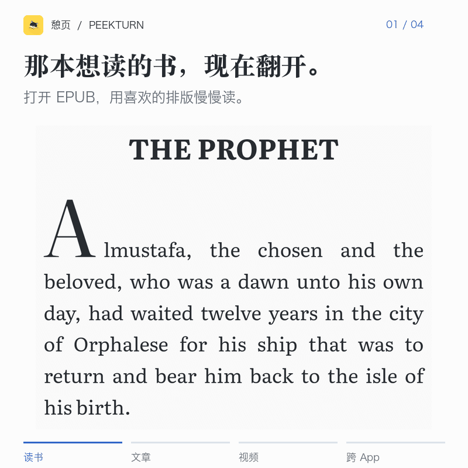

# 憩页 · Peekturn

### 读懂一个词，走近一个更大的世界。

翻开那本一直想读的书，留下一篇值得细读的文章，再看一段让你好奇的视频。憩页把词义放在内容旁边，让你少一点来回切换，多读懂一点。

这是一款面向已有一些英语基础、想从真实内容中学到东西的 Android 阅读与视频 App。**读书、导入文章、看视频，都能在语境里查词；去其他 App 阅读时，也能把悬浮查词带过去。**

**[下载 Android APK](https://github.com/Wake-C/peekturn/releases/latest)** · Android 8.0+ · [English](README.en.md)

<picture>
  <source media="(prefers-reduced-motion: reduce)" srcset="assets/video/peekturn-intro-cover-zh.jpg">
  <source type="image/webp" srcset="assets/video/peekturn-intro-zh.webp">
  
</picture>

Android 模拟器实录，使用憩页的「经典白」主题。[完整录屏（MP4）](assets/video/peekturn-intro-zh.mp4) · [GIF 版本](assets/video/peekturn-intro-zh.gif) · [静态截图](assets/video/peekturn-intro-cover-zh.jpg)

## 一本书，按自己的节奏读

导入 EPUB，或直接打开内置的纪伯伦《先知》。选择喜欢的字体、字号、间距和主题，阅读位置自动保存。也可以从当前句子开始朗读，调整倍速，锁屏后继续听。

## 不离开书页，读懂这一句

选中单词或短语，在书页旁查看释义、语境解释、例句和发音。关掉解释窗口，接着读刚才那一段。离线词典不用配置，AI 语境解释需要连接自己的服务，也可能出错。

## 把一篇好文章，留在书架里

粘贴文章链接，或从其他 App 分享过来。在导入浏览器中打开全文，点一下导入，就能用读书的方式读文章：调整排版、选词解释、朗读，继续上次读到的地方。

## 看视频，也能抓住词句

导入公开 YouTube 链接，跟着字幕看，遇到生词就点开，再回听这一句，接着往下看。不需要画面时，可以切换到仅音频模式。下载完成的音频、视频及可用字幕支持离线播放。

## 查词，跟着你走

在其他 App 里读到不懂的词？**把憩页的悬浮查词拖到英文单词上。** 松手时截取屏幕，在手机上识别文字，释义直接出现在原来的页面上，不必把句子复制到另一个 App。

离线词典可以直接用，连接自己的 AI 服务后还能看语境解释。此功能需要屏幕共享权限，受保护的页面或禁止悬浮窗的 App 可能无法使用。

## 先读起来

1. **安装并打开憩页。** 可以直接读内置的纪伯伦《先知》，也可以导入自己的 EPUB 或文章。
2. **选一段你想读懂的内容。** 遇到生词就选中查词，想听时从当前句子开始朗读。看视频时，在「视频」中粘贴 YouTube 链接，或从其他 App 分享过来。
3. **需要语境解释时，再配置 AI。** 在「设置」中填写自己的模型服务、模型名和 API Key。服务商可能收费，解释也可能出错。

在其他 App 里查词

在设置中开启悬浮查词，或把「悬浮查词」加入 Android 快捷设置。将悬浮图标拖到其他 App 的英文单词上，即可查看解释或离线词典。图标靠边收起后，先点一下展开，再拖动。

需要悬浮窗权限，每次启动还需确认系统屏幕共享。可从快捷设置、图标上的「停止」或通知结束共享。受保护的页面可能无法识别。

导入网页文章

支持 Substack、WordPress、Ghost 和静态博客的常见排版，包括独立域名。X、Anthropic、OpenAI 等网页使用通用文章提取。如果只能看到付费预览，请先在导入浏览器中登录或打开你有权访问的全文，再导入。

## 内容与隐私

- 书籍、字幕、阅读与观看进度、学习统计保存在设备上。API Key 在设备上加密保存。
- AI 解释会把选中文字和少量上下文发送给你配置的服务。在线发音与朗读会把要读的文字发送给相应语音服务。
- 跨 App 查词默认关闭，只在松开图标时截取屏幕，并在本机识别文字。截图和识别出的文字不会保存到解释缓存。
- 视频和字幕能否获取取决于来源。临时缓冲不等于离线下载，请仅下载你有权保存的内容。字幕分组不会纠正原有的识别错误。

录屏内容：纪伯伦的[《先知》](https://www.gutenberg.org/ebooks/58585)、NASA Space Place 的 [Why Is the Sky Blue?](https://spaceplace.nasa.gov/blue-sky/en/)，以及 [Kurzgesagt - In a Nutshell](https://www.youtube.com/@kurzgesagt) 的 *The Drug To Master Reality*。跨 App 查词录制于 Chrome，演示的是同一篇 NASA 文章。

---

[第三方声明](THIRD_PARTY_NOTICES.md) · [源码许可](LICENSE) · [开发与交付](agent-doc/essential/DELIVERY.md)
