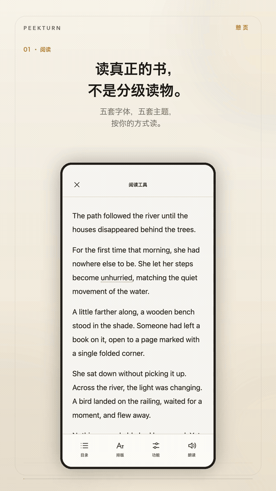

# 憩页

<p align="center"></p>

一个帮你把英文原版书读完的 Android 阅读器。

**[下载 Android APK](https://github.com/Wake-C/peekturn/releases/latest)** · [English](README.md) · 版本 1.3.0 · Android 8.0+

## 你完整读完过一本英文书吗？

不是分级读物，不是书摘，是一本真正的书，从第一页读到最后一页。

市面上的英文阅读 App 已经够多了。更多功能、更多翻译、更多课程、更多打卡，看起来什么都能做。但用了这么多之后，你的英文真的成长了吗？

词汇的成长，和对一个词的语感，不是靠收集定义得来的。它来自在真实语境里反复遇见同一个词，直到这个词的含义变成一种感觉，而不只是一条需要背诵的解释。

所以憩页只做最核心的几件事：

- 把书朗读出来；
- 记住一个词的核心含义；
- 理解它在这个上下文里的含义；
- 给出能说明用法的例句。

目的不是背完一个定义就翻页，而是从一个词的用法和文化里理解它，同时不停下来，继续把书读下去。

## 看它怎么读

<p align="center"></p>

28 秒循环一遍：阅读、朗读、查词，以及从 URL 导入文章。

## 它做什么

- 导入原始 EPUB 书，也可以从 URL 或 Android 分享导入文章。书名和作者会尽量保留。
- 关掉 App、重启手机或改字号后，仍然回到原来的阅读位置。
- 选中单词或短语后，给出核心含义、当前语境中的含义和例句。
- 包含离线词典、在线单词和例句发音、美式或英式口音选择，以及可选自动播放。
- 从当前句子连续朗读，带播放、暂停、上一句、下一句、下一段、速度和停止。提前准备后续段落，锁屏后继续播放，已生成的音频会保存在本地供离线重听，也包括 Android 系统语音。
- 五套阅读字体，可调字号、字距、行距和页边距；五套主题；界面语言可选跟随系统、English 或简体中文。
- 显示真实的阅读时长。没有编造的统计或演示答案。
- 首次安装自带纪伯伦的《先知》，来自 Project Gutenberg，在美国属于公版。它和普通导入的书一样留在本地书库。

解释使用你自己配置的 AI 服务。在设置里填写 HTTPS 地址、模型名和 API Key。憩页不内置 Key，也不提供演示答案。连接测试是真实请求，可能产生费用。

在**设置 → 发音**中选择 **Android 系统语音**，再打开**系统语音设置**选择 Android 的首选引擎。模型、音色和语言由引擎自己的 App 管理，憩页不会覆盖。更换系统引擎后，下一次朗读会使用新引擎；从系统或引擎设置返回后，也会刷新语音连接，无需重启憩页。

系统朗读缓存按引擎版本、引擎报告的音色和合成配置隔离。配置未变时，刷新连接也会复用已有音频。引擎无法报告音色时，只在当前连接内复用。若引擎更换内部模型却仍报告相同音色信息，请在设置中清除句子音频。若持续生成速度低于播放速度，预生成的音频仍会耗尽。

冷启动会先准备当前句子、两个完整的后续段落和至少 15 秒可播放音频，再开始朗读；之后继续储备，目标为八个后续段落和随生成速度调整的音频时长。到达书尾、内容不可用或触及资源上限时，储备可能少于目标，界面显示实际已准备的内容。补充储备时最多允许两个合成请求，储备充足后使用一个；引擎内部仍可能串行推理。暂停会保留已完成的音频，但不继续生成。

朗读会话开始后，上一句、下一句和暂停恢复可直接播放与当前音色匹配的已完成音频，不再等待后续段落。后台仍继续准备音频；后面的句子若尚未缓存，仍可能停顿。首次冷启动及没有缓存的重新准备仍遵循上述储备策略。

使用较慢的神经网络音色时，可以打开**朗读 → 已保存 → 准备整本书**。应用会按当前书籍和音色逐句保存音频，支持暂停和继续准备。锁屏后也能继续；应用被停止后，可回到“已保存”继续。开始实时朗读或单词发音时，会先暂停准备任务。准备更多音频前，需要停止朗读。

整本书准备完成后，点**播放**即可从当前阅读位置收听，沿用现有的切句和播放控件，隐藏阅读工具栏后也不变。播放已保存音频无需实时合成或联网。已保存版本与临时句子缓存分开存放，清除缓存不会删除它们。要保存另一种音色，先在设置中更换音色，再点**准备当前音色**；要重新生成某个版本，先删除它。删除前需要停止该版本的播放。

准备已保存音频需要引擎提供明确的音色信息。信息尚未就绪时，请在引擎设置中选择音色后重试，或使用实时朗读。已保存的音频缺失或损坏时，播放会停止并提示，不会自动切换成实时合成。

在**阅读功能**中开启**音量键切句**后，阅读页朗读期间可以用音量加跳上一句、音量减跳下一句，默认关闭。

设置中的开发者报告会显示近期日志，磁盘上限为 256 KiB，可复制内容最多 16 KiB，超限时淘汰最旧记录。朗读日志关联播放操作、缓存状态、缓冲等待与合成请求，记录重连和取消原因，并在请求等待 15 秒仍未完成时提示一次，不记录阅读原文和密钥。清除日志不会删除书籍、偏好或句子音频。

## 从网页导入

粘贴 https 链接，或从其他 App 分享链接。憩页会提取文章正文，作为一本书加入书库。

可以导入 X 长文、OpenAI 和 Anthropic 的文章、Paul Graham 的随笔，以及许多常见博客的文章页。遇到登录或人机验证时，在导入浏览器里完成后再点导入。只显示预览、或没有可读正文的页面不会导入。

## 它不做什么

- 不做整书翻译，书保持原来的排版。
- 不做背单词、闪卡或连续打卡。
- 不做云书库、账号或同步。
- 不编造示例书库或阅读数据；唯一内置的是一本真实的公版书。

## 构建

需要 JDK 17 和 Android SDK platform 35。设置 `ANDROID_HOME`，或在未跟踪的 `local.properties` 中写入 `sdk.dir=...`。

运行检查并生成带 SHA-256 和构建凭据的版本化 debug APK：

```sh
./tools/package-apk.sh
```

这条命令需要 POSIX shell、Python 3 和 Git。它会运行 debug 单元测试、Android lint 和 APK 组装，不会改动源码或版本号，也不配置发布签名。

只构建 debug APK：

```sh
./gradlew :app:assembleDebug
```

debug APK 是通用包。macOS 上，如果未设置 `JAVA_HOME`，Gradle wrapper 会选择已安装的 JDK 17。其他平台请提供 Java 17。

签名正式版见[发布流程](RELEASE.md)。

## 隐私

书籍、进度、偏好和阅读统计都留在设备上。没有账号，也没有云书库。

请求解释时，只会把你选中的文字、少量前后文和可用的书名或章节名发送到你配置的服务。API Key 在设备上加密保存。在线发音发送你要求听到的单词或句子；连续朗读还会把有限的后续段落发送给所选服务。使用在线音色准备整本书时，会逐句向该服务发送书籍文本，Android 系统引擎也可能使用联网音色。离线词典不联系任何服务商。具体音频路由和署名见[第三方声明](THIRD_PARTY_NOTICES.md)。

## 更多

- [发布流程](RELEASE.md)
- [第三方声明](THIRD_PARTY_NOTICES.md)
- [Apache-2.0 许可证](LICENSE)
