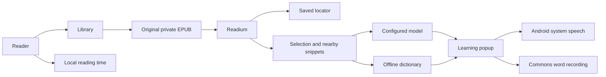

# Architecture

## Actors and flow

The reader imports an original EPUB into the local library, resumes a stable book location, and selects language for optional assistance. Readium presents the publication. The app supplies nearby selected-text context to the configured model, or queries the offline dictionary. Individual words can use licensed Commons recordings; Android TTS speaks phrases/examples and supplies word fallback. Local statistics aggregate actual reading activity.

## Ownership

Code paths below are relative to `app/src/main/java/app/margin/reader/` unless they name a repository-level file.

- `model/`: stable application data contracts. Readium locator JSON stays opaque outside reader integration.
- `data/`: SQLite library and time records, settings and encrypted credentials, independently sourced dictionary.
- `reader/`: Readium opening/import/navigation, original EPUB file lifecycle, selection integration and reader controls.
- `learning/`: provider request/stream/structured response handling and the learning popup.
- `speech/`: recorded-word lookup, system speech, playback ownership and cancellation.
- `ui/`: Focus app shell, library, statistics, settings and design tokens.
- `MarginApp.kt`: application-scoped `AppGraph` composition; Activities own screen lifecycles.

## Technical decisions

Native Kotlin/Compose app shell with the unmodified Readium Fragment navigator. Build manifests own the exact toolchain and dependency versions. Readium changes must preserve compatibility with publication-content transforms, selection geometry, the navigator factory and saved-locator restoration; an alpha navigator is not an implicit prerequisite.

Original EPUBs remain in app-private storage. SQLite persists library metadata, locator JSON and daily reading time. Settings are local; API credentials are encrypted with Android Keystore and excluded from backup. The UI observes repository state, not direct database queries.

LLM network access belongs to model actions; publication content is local-only. Word-audio actions send only a single selected term to Wikimedia Commons and retain recording attribution, never source context or model credentials. Book reading and dictionary lookup remain offline. Usable installed English voices support sentence speech without a model or recording source; engines may use their own network voices if no usable offline English is available.

Toolchain setup, wrapper behavior and Android build/install commands belong to [README: Build and run](../../README.md#build-and-run).

## Shared settings and persistence

`ui/Theme.kt` owns application color roles. `AppSettings.appTheme` is the single appearance source for shell, reader, dialogs and learning popups. Screens consume semantic roles, not dark-only constants or a second reading theme.

Preferences are field transformations applied inside the persistence lock, not stale whole-settings snapshots. `AppSettings.profiles` and `activeProfileId` own model configuration; `model` is the computed active configuration, not a second stored object. API-key material is encrypted per profile and stored separately from generic settings JSON. Existing single-model/key data migrates once. Android cloud backup and device transfer exclude private app data.
