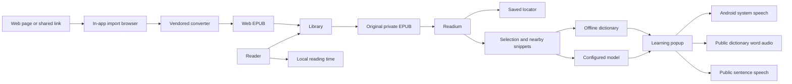

# Architecture

## Actors and flow

The reader imports an original EPUB into the local library, or converts a web page into an EPUB in an in-app browser and imports that, resumes a stable book location, and selects language for optional assistance. Readium presents the publication. The app supplies nearby selected-text context to the configured model, or queries the offline dictionary. Single words can use public online dictionary audio, and phrases, examples and words without it can use public online speech services; Android system speech speaks the fallback. Local statistics aggregate actual reading activity.

## Ownership

Code paths below are relative to `app/src/main/java/app/margin/reader/` unless they name a repository-level file.

- `model/`: stable application data contracts. Readium locator JSON stays opaque outside reader integration.
- `data/`: SQLite library and time records, settings and encrypted credentials, independently sourced dictionary.
- `reader/`: Readium opening/import/navigation, original EPUB file lifecycle, selection integration and reader controls.
- `webimport/`: in-app import browser, link policy, JavaScript bridge and page-to-EPUB handoff; the converter itself is vendored under `app/src/main/assets/webimport/`.
- `learning/`: provider request/stream/structured response handling and the learning popup.
- `speech/`: online word and sentence audio lookup, system speech, playback ownership and cancellation.
- `ui/`: Focus app shell, library, statistics, settings and design tokens.
- `MarginApp.kt`: application-scoped `AppGraph` composition; Activities own screen lifecycles.

## Technical decisions

Native Kotlin/Compose app shell with the unmodified Readium Fragment navigator. Build manifests own the exact toolchain and dependency versions. Readium changes must preserve compatibility with publication-content transforms, selection geometry, the navigator factory and saved-locator restoration; an alpha navigator is not an implicit prerequisite.

Original EPUBs remain in app-private storage. SQLite persists library metadata, locator JSON and daily reading time. Settings are local; API credentials are encrypted with Android Keystore and excluded from backup. The UI observes repository state, not direct database queries.

LLM network access belongs to model actions; publication content is local-only. A word-audio action sends only a single selected word to a public dictionary audio service, and a phrase, example or word without dictionary audio sends only that exact text to a public speech service — never source context, book or chapter titles or model credentials — and, when that service answers nothing, retries the same text once against a second key-free speech service; the returned audio is memory-only. Book reading and dictionary lookup remain offline. System speech is the fallback when no online service answers, and engines may use their own network voices if no usable offline English is available.

Web import stays on the device. The page is rendered by the app's WebView with the reader's own network and login state, because bot protection answers plain HTTP clients and headless browsers with a challenge while a real browser session passes. A direct fetch is attempted first and falls back to that browser. The converter is a vendored, unmodified open-source pipeline (Mozilla Readability plus the save-as-ebook extractor and EPUB writer); the app adds only a host shim and a bridge, so there are no per-site adapters and one upstream upgrade path. The produced EPUB enters the same importer, which is why reading, dictionary, speech and statistics need no web-specific branch.

Toolchain setup, wrapper behavior and Android build/install commands belong to [README: Build and run](../../README.md#build-and-run).

## Shared settings and persistence

`ui/Theme.kt` owns application color roles. `AppSettings.appTheme` is the single appearance source for shell, reader, dialogs and learning popups. Screens consume semantic roles, not dark-only constants or a second reading theme.

Preferences are field transformations applied inside the persistence lock, not stale whole-settings snapshots. `AppSettings.profiles` and `activeProfileId` own model configuration; `model` is the computed active configuration, not a second stored object. API-key material is encrypted per profile and stored separately from generic settings JSON. Existing single-model/key data migrates once. Android cloud backup and device transfer exclude private app data.
