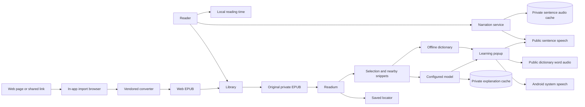

# Architecture

## Actors and flow

The reader imports an original EPUB into the local library, or converts a web page into an EPUB in an in-app browser and imports that, resumes a stable book location, and selects language for optional assistance. Readium presents the publication. The app supplies nearby selected-text context to the configured model, or queries the offline dictionary. Single words retain public dictionary audio and the existing speech fallbacks. Phrases, examples and continuous read-aloud share a Settings-owned speech provider choice: Microsoft by default, Android system TTS or Baidu English, with no silent provider switching. Continuous narration keeps its foreground service and private online-audio cache. Local statistics aggregate actual reading activity.

## Ownership

Code paths below are relative to `app/src/main/java/app/peekturn/reader/` unless they name a repository-level file.

- `model/`: stable application data contracts. Readium locator JSON stays opaque outside reader integration.
- `data/`: SQLite library and time records, settings and encrypted credentials, independently sourced dictionary.
- `reader/`: Readium opening/import/navigation, original EPUB file lifecycle, selection integration and reader controls.
- `webimport/`: in-app import browser, link policy, JavaScript bridge and page-to-EPUB handoff; the converter itself is vendored under `app/src/main/assets/webimport/`.
- `learning/`: provider request/stream/structured response handling, the learning popup and the app-scoped persistent explanation cache.
- `speech/`: online word and sentence audio lookup, system speech, playback ownership and cancellation.
- `narration/`: continuous sentence read-aloud, its foreground MediaSession service, bounded prefetch, Readium TTS engine and persistent sentence-audio cache.
- `diagnostics/`: bounded private developer logs, safe device/engine snapshots, exception sanitization and crash-handler delegation.
- `ui/`: Focus app shell, library, statistics, settings and design tokens.
- `PeekturnApp.kt`: application-scoped `AppGraph` composition; Activities own screen lifecycles.

## Technical decisions

Native Kotlin/Compose app shell with the unmodified Readium Fragment navigator. Build manifests own the exact toolchain and dependency versions. Readium changes must preserve compatibility with publication-content transforms, selection geometry, the navigator factory and saved-locator restoration; an alpha navigator is not an implicit prerequisite.

Original EPUBs remain in app-private storage. SQLite persists library metadata, locator JSON and daily reading time. Settings are local; API credentials are encrypted with Android Keystore and excluded from backup. The UI observes repository state, not direct database queries.

LLM network access belongs to model actions; publication content is local-only. A word-audio action sends only a single selected word to a public dictionary audio service and retains its existing Microsoft, Baidu and system-speech fallbacks. Phrases and examples use only the selected sentence provider and send only their exact requested text to an online service, never source context, book or chapter titles or model credentials; their audio is memory-only. Book reading and dictionary lookup remain offline. Android system speech prefers offline English voices but may use engine-provided network English voices.

Continuous narration is separate from lookup pronunciation. It runs in a MediaSessionService so screen-off playback does not depend on the reader Activity and uses Readium's own TTS navigator with the shared selected provider. Microsoft and Baidu request the current sentence plus at most two following sentences without cross-provider retry. Each complete sentence is one cache and playback unit; long online sentences are assembled from bounded transport chunks and oversized sentences fail explicitly instead of being truncated. Online cache keys separate provider and voice. The cache lives in no-backup app-private storage with opaque SHA-256 names, complete MPEG-frame validation, a 16 MiB per-sentence ceiling and a 4 GiB least-recently-used total bound. Byte usage is initialized once and maintained under the cache lock; the directory is enumerated only when a write crosses the bound, then trimmed in one batch to a low-water mark. Android system narration bypasses the audio cache. It is not Android backup data and contains no book file or text. Popup word and example audio remains memory-only, and setting up or clearing narration does not alter model credentials.

Successful model explanations are also reusable across reader sessions and process restarts in an app-scoped, no-backup cache. An entry is keyed by the exact provider-clipped selection and surrounding context, book and chapter identity, book/chapter titles, explanation language and provider configuration; changing any of them is a new request. Only complete validated answers are stored, for an absolute fifteen days from completion; reads do not extend that lifetime. The 1 GiB budget evicts least-recently-used records only when exceeded, and a 512 KiB per-record ceiling keeps one malformed answer from dominating it. Settings shows usage and a manual clear. Clear advances a generation before deleting, so an in-flight answer cannot repopulate the cache; clearing cache never deletes books, reading positions, statistics or model configuration.

Web import stays on the device. The page is rendered by the app's WebView with the reader's own network and login state, because bot protection answers plain HTTP clients and headless browsers with a challenge while a real browser session passes. A direct fetch is attempted first and falls back to that browser. The converter is a vendored, unmodified open-source pipeline (Mozilla Readability plus the save-as-ebook extractor and EPUB writer); the app adds only a host shim and a bridge, so there are no per-site adapters and one upstream upgrade path. The produced EPUB enters the same importer, which is why reading, dictionary, speech and statistics need no web-specific branch.

Toolchain setup, wrapper behavior and Android build/install commands belong to [README: Build](../../README.md#build).

## Shared settings and persistence

`ui/Theme.kt` owns application color roles. `AppSettings.appTheme` is the single appearance source for shell, reader, dialogs and learning popups. Screens consume semantic roles, not dark-only constants or a second reading theme.

Preferences are field transformations applied inside the persistence lock, not stale whole-settings snapshots. `AppSettings.profiles` and `activeProfileId` own model configuration; `model` is the computed active configuration, not a second stored object. API-key material is encrypted per profile and stored separately from generic settings JSON. Existing single-model/key data migrates once. Android cloud backup and device transfer exclude private app data.

`AppLanguage` applies the persisted locale at application startup and on language changes. Activities use AppCompat so cold shares and reading screens receive the same locale on Android versions before per-app system locale support. Global Settings owns appearance, interface language, provider profiles and pronunciation setup; reading behavior lives in the reader's Options sheet and typography has its own sheet.

Developer diagnostics are local support data, not telemetry. `PeekturnApp` installs the crash handler before feature composition and delegates to the original handler after a synchronous best-effort crash record. Normal events use one background writer; Settings exports and copies a fresh snapshot after draining pending writes. Storage rotates at 256 KiB under no-backup app-private storage. Reports omit credentials, provider URLs, book titles/paths/text, selections, prompts, model output and exception messages. Exception records retain validated class/method identities and line numbers only; Android 11+ exit history includes own-app reason/status summaries, not descriptions or trace streams.
