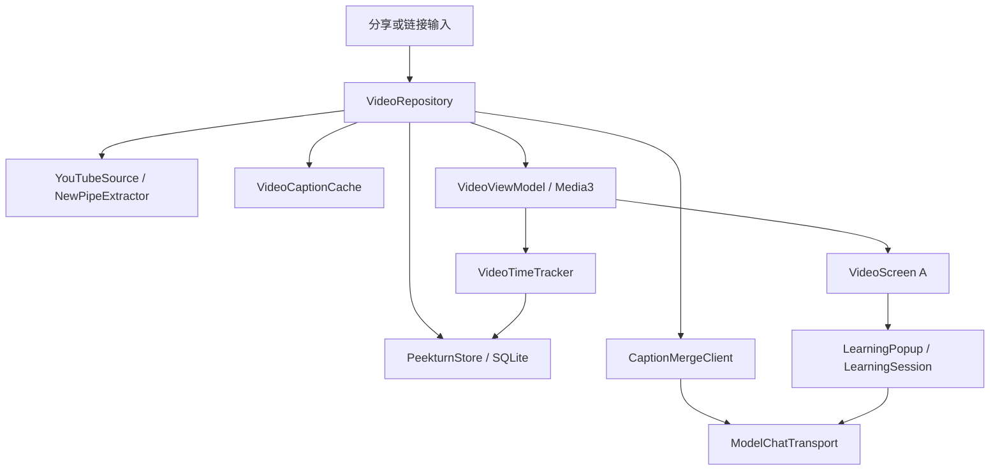

# Video A：冻结需求与实现规格

状态：开发基线，冻结后开发 Agent 不得修改。负责人：主 Agent。适用版本：Peekturn 1.4.0，versionCode 12。用户已选择最终 A 方案并授权开发、测试、验收和本地签名交付，未授权提交、推送或发布。

本文件按用户明确要求建立，作为这次开发的唯一功能规格，不另建竞争版本。发现接口或需求冲突时，开发者报告事实、影响、建议及证据，由主 Agent 决定并写入 `ACCEPTANCE.md` 的偏差记录。不得为让测试通过而更改本文件、削弱验收条件或把未实现功能改成非目标。冻结哈希由主 Agent 在分工记录中登记。

## 1. 目标与成功标准

用户从 YouTube 分享一个视频或粘贴链接，在同一个 Peekturn App 内加入 Video，取得真实视频和字幕，以 A 方案观看、点词、解释、继续观看。Library 的 EPUB、网页转 EPUB、阅读位置和现有朗读不受影响。

必须交付的完整路径：分享或链接输入 → 识别并规范化视频 → 解析真实媒体及字幕轨 → 加入独立视频列表 → 在线播放 → 跟随字幕 → 原始／合并字幕开关 → 单词或短语语境解释 → 恢复正确播放状态 → 保存位置 → 汇入原统计界面 → 缓存清理后仍能找到条目和位置。

真实验收视频：`https://youtu.be/u4LUix-BU0s?is=BhXx5x4PxA_D40U4`。规范身份为 `u4LUix-BU0s`，规范链接为 `https://www.youtube.com/watch?v=u4LUix-BU0s`。预检实际取得标题 `The Drug To Master Reality`、作者 `Kurzgesagt` 频道、时长 679 秒、英语人工及自动字幕、MP4 媒体流。NewPipeExtractor v0.26.5 的原生 JVM 预检得到人工 VTT HTTP 200、自动 VTT HTTP 200、MP4 范围请求 HTTP 206。上述结果不是 Android 播放验收的替代品。

本次不做推荐流、订阅、评论、整片下载、后台视频播放、离线视频库、全片 ASR、视频再配音、视觉识别、词汇收藏或第二个 App。逐词同步高亮不作为本次功能；保留当前句和点选词高亮，不用估算时间伪造逐词同步。测试员由 Agent 执行任务式设备测试，不得把这种测试描述为招募了真实人类参与者。

## 2. 产品入口与信息结构

底部导航固定顺序为 Library、Video、Statistics、Settings。Library 仍为索引 0，Video 为 1，Statistics 为 2，Settings 为 3。主导航页面不重复显示 App 名称或页面大标题，保留内容分区标题和导入动作。Video 是独立实体，不能往 books 表塞假 EPUB，也不能调用 EpubImporter 打开视频。

Video 列表沿用 A：一个紧凑的继续观看条目、全部视频列表、导入动作；真实标题、频道、时长和位置来自导入结果。空库显示诚实空态和导入入口，不预置演示视频。列表允许打开、删除及确认删除。删除视频清理该视频字幕缓存、位置、该视频时长记录，遵循现有删除书籍时长随条目删除的规则，不影响书籍或其他视频。

导入入口有两个：Video 的链接输入框和现有 ImportShareActivity 的 ACTION_SEND text/plain。分享文本包含标题和链接时使用其中的第一个 HTTP(S) 链接。YouTube 域名走 Video，不走网页正文抓取；其他网页继续原有 WebImport。EPUB stream 分享路径保持原样。不增加本地视频文件导入功能。

视频 Activity 必须支持重复分享及 onNewIntent。重新分享同一视频不能增加重复条目；带明确时间的链接优先使用该时间，未带时间使用保存位置。从分享独立进入后返回，应能到 Video 列表而不是误开上次 EPUB。MainActivity 接收明确 Video 导航意图时跳过 lastBook 的自动重开。

## 3. 链接识别契约

支持 `youtube.com/watch?v=ID`、`www.youtube.com`、`m.youtube.com`、`youtu.be/ID`、`youtube.com/shorts/ID` 和 `youtube.com/embed/ID`。ID 恰好 11 个 ASCII 字母、数字、下划线或连字符。协议仅 HTTP(S)，处理后规范为 HTTPS。接受分享文本中 URL 后的正常标点，拒绝用户名密码、伪造域名如 youtube.com.evil.example、空 ID、频道链接以及没有视频 ID 的播放列表。

`t` 或 `start` 接受非负秒数和 `1h2m3s`，转为 Long 毫秒，拒绝溢出。播放时夹到真实时长。`si`、`is`、其他追踪参数、playlist 参数不进入身份及持久缓存键。链接含列表与有效视频 ID 时仅导入这一个视频。不请求 YouTube 登录凭据，不导入浏览器 Cookie，不突破付费、私密或年龄权限限制。

无效 YouTube 链接明确报错，不能偷偷改走网页导入。真实支持范围为可访问的公开视频点播；直播、已删除、私密、地区限制、访问验证和网络失败都必须有可区分的失败类别。网络可达不代表内容必定可获取。

## 4. 最终 A 交互

### 4.1 竖屏

画面固定在上方，保持原视频比例并完整 contain，不拉伸或裁切。下方是独立可滚动字幕流，当前句有轻量背景强调。正常字号时字幕区占主要剩余空间，不为解释或工具动态压缩视频。字幕行显示简短时间，点击时间或非单词空白区域跳到该句；点击单词查词，长按支持选词或短语，避免一次手势同时跳转和解释。

播放工具默认隐藏。画面本身只有透明交互区域，不出现中央播放图标、黑色运输控制遮罩、上一句／下一句、时间或进度数字。点击画面仅显隐固定在屏幕底部的工具，不触发播放或暂停。底部工具含当前时间、总时长、seek、上一句、播放／暂停、下一句、倍速和收起动作。它是独立覆盖层，不改变视频或字幕容器的测量边界。字幕保留恒定的末尾滚动余量，最后一句始终可滚到工具上方。

没有“点击单词查看解释”“点按跳转”等教学式文案。图标需要无障碍 contentDescription。单词命中是独立文字区域，不能为扩大按钮把整句拆成间距不自然的芯片。

### 4.2 横屏全屏

视频使用整屏完整 contain。上一句、播放／暂停、下一句在屏幕几何中心对称排列，播放按钮为主按钮。底部仅保留时间、进度和倍速，顶部有返回、视频标题、播放设置及回竖屏动作。进入横屏时控件可见，点击非字幕、非控件的画面区域显隐整组控制。此操作不改变播放状态。隐藏时字幕仍显示并可点词。没有自动隐藏倒计时，避免新增未约定的时序。

字幕位置在控件显隐前后不变。字幕点词不得顺带显示或隐藏播放器控制。播放控制和字幕均在视频上层，但解释是另一个独立层，不共用动态横向分栏。

### 4.3 解释浮层

选词后先暂停并固定视频位置、被选文字、原句和相邻语境，再请求解释。横屏解释居中，最大宽度约 480dp，四周至少 12dp 安全空间，内容区可滚动，关闭和重听动作保持可见。背景可轻度变暗，但视频尺寸、字幕宽度及位置、播放器对象都不能变化。竖屏沿用现有学习弹层的底部位置，保持画面可见。

复用现有解释／词典页、发音、语言偏好、流式答案、取消与缓存。视频不显示 EPUB 专用“调整”按钮。关闭按钮与恢复按钮区分：普通取消或系统 Back 关闭并保持暂停；明确的继续观看仅恢复本次查词造成的暂停。进入前手动暂停、进入后台、失去音频焦点、用户 seek 或已换视频时，旧请求不能自动恢复。重听本句是明确 seek 到所选显示句起点并播放的动作，不自动跳句或反复循环。

连续换词时旧请求必须取消或失去提交资格，不能覆盖新词。旋转屏幕保留同一播放意图、位置和选词身份；不得因重组触发新的重复解释请求。

### 4.4 字幕设置

右上角功能按钮进入播放设置，包含全局持久的合并字幕开关、可用字幕轨选择及本视频字幕缓存管理。主播放器不出现“原始字幕／优化字幕”显眼分段选择器。

合并默认关闭。打开时命中缓存直接应用；无缓存则使用当前全局模型，处理中继续显示原字幕。关闭立即恢复原字幕，不删合并缓存。关闭后即使在途任务完成，也只能缓存结果，不能把开关重新打开。模型变更不自动重算已有结果，显式重新生成使用新配置。

切换字幕轨取消旧轨解释／合并显示，保存选择，读取新轨缓存或明确加载状态。默认优先英语人工轨，再英语 ASR，再首个实际可用轨，并显示语言和自动生成标记；不伪装为英语、不自动翻译。视频可以在没有字幕时播放，但查词和合并不可用。没有字幕与字幕拉取失败是不同状态。

## 5. 模块结构和选型

单个 Android app 模块内增加 `video/` 包，沿用 Kotlin、Coroutines、Compose、SQLiteOpenHelper、OkHttp 和 Gson，不引入新 UI 框架、Room、Python 或服务端。

依赖固定：`com.github.TeamNewPipe:NewPipeExtractor:v0.26.5`，JitPack 仅允许 TeamNewPipe 组；Media3 的 exoplayer、ui、exoplayer-hls、exoplayer-dash、datasource-okhttp 均为 1.6.0，与现有 media3-session 对齐。minSdk 26 需要把 desugaring artifact 改为 `desugar_jdk_libs_nio:2.1.5`。版本元数据及实际许可证记录在第三方声明中，不能把非官方提取说成官方授权接口。

模块关系：



源码解析和字幕缓存不放进 Composable。播放状态、选词暂停所有权和异步请求代次由 VideoViewModel 单点管理。Compose 只读取状态和发送动作。YouTubeSource 只解析源，不依赖 Activity、SQLite 或播放器。

## 6. 固定公共数据契约

以下类型由集成负责人建立在 `video/VideoModels.kt`。开发 Agent 不得擅自改变字段名称或单位。附加内部实现类型允许，但跨模块变化需报告。

```kotlin
data class VideoLink(val videoId: String, val startMs: Long? = null) {
    val canonicalUrl: String get() = "https://www.youtube.com/watch?v=$videoId"
}
data class VideoMetadata(val videoId: String, val title: String, val author: String,
    val durationMs: Long, val thumbnailUrl: String?)
data class VideoItem(val id: Long, val videoId: String, val title: String, val author: String,
    val durationMs: Long, val thumbnailUrl: String?, val positionMs: Long = 0,
    val lastWatchedAt: Long = 0, val selectedTrackId: String? = null)
data class CaptionTrack(val id: String, val language: String, val automatic: Boolean,
    val url: String)
data class VideoPlaybackSource(val videoUrl: String, val videoMimeType: String,
    val audioUrl: String? = null, val audioMimeType: String? = null,
    val headers: Map<String, String> = emptyMap())
data class ResolvedVideo(val metadata: VideoMetadata, val playback: VideoPlaybackSource,
    val tracks: List<CaptionTrack>)
data class CaptionCue(val id: Int, val startMs: Long, val endMs: Long, val text: String)
data class CaptionDocument(val videoId: String, val trackId: String, val language: String,
    val automatic: Boolean, val sourceHash: String, val cues: List<CaptionCue>)
data class CaptionGroup(val firstCueId: Int, val lastCueId: Int)
enum class VideoFailureKind {
    InvalidLink, Network, Unavailable, Restricted, Unsupported, Captions, Provider, Storage
}
class VideoFailure(val kind: VideoFailureKind, cause: Throwable? = null) : Exception(kind.name, cause)
data class VideoSessionData(val item: VideoItem, val resolved: ResolvedVideo,
    val captions: CaptionDocument?, val captionFailure: VideoFailureKind? = null)
```

外部地址只存在于 `ResolvedVideo` 的当前会话。不得把 signed stream URL、caption URL、Cookie 或 token 放进 SQLite、诊断日志或导出信息。可持久化公开规范链接和 thumbnail URL。字幕轨 ID 使用语言、自动标记及稳定源标识，不使用过期 URL 做唯一身份。

时间字段一律为 Long 毫秒，累计统计一律为真实经过的秒数。duration 为 0 表示未知，不能伪造时长。最终字幕 cue 必须 start >= 0、end > start、文本非空、id 连续且稳定、有序。允许源字幕重叠，不得把重叠误认为合法词序被打乱。

## 7. 源解析模块接口

```kotlin
object YouTubeUrls {
    fun parse(text: String): VideoLink?
    fun isYouTubeUrl(text: String): Boolean
}
class YouTubeSource(http: OkHttpClient = defaultVideoHttpClient()) {
    suspend fun resolve(videoId: String): ResolvedVideo
    suspend fun captions(videoId: String, track: CaptionTrack): CaptionDocument
}
fun parseVideoCaptions(videoId: String, track: CaptionTrack, payload: String): CaptionDocument
```

YouTubeSource 用 OkHttp Downloader 适配 NewPipe，初始化只能有一个所有者。执行在 IO dispatcher，支持 coroutine 取消。超时必须有界，不捕获 CancellationException 伪装业务失败。不给应用添加固定代理地址；设备的网络由 Android 默认代理／VPN 决定。

优先选择带音频的 MP4，最高不超过 720p；没有合流时选择可被平台解码的 MP4 视频流及 M4A/AAC 音频，交给 Media3 合并。不得返回仅视频而假装有声。不能取得媒体时不能把仅标题条目标记为导入成功。

字幕请求优先 VTT。解析可复用 Media3 文本解析能力，应用只处理 YouTube 的滚动显示归一化和稳定 cue 映射。人工字幕保留词与标点。ASR 滚动字幕中重复显示的前一行，只在时间连续且确认为同一显示内容时去重；真实口语重复词不可删。HTML 标记仅用于格式，不能执行或作为模型指令。保存的 sourceHash 对规范 cue 文本和时间序列做 SHA-256。

上限：字幕响应 20 MiB，最多 100000 个 cue；超过上限给出字幕失败，不阻止已经可用的视频播放。不能把空 HTTP 200、验证页面或错误 HTML 当字幕成功。原始文件和解析结果属于内容私有数据，不写日志。

## 8. 持久化、仓储与缓存接口

PeekturnStore 的现有 DB 从 1 升到 2，只新增 videos 与 video_daily，不重建 books 或 reading_daily。videos 的 video_id 有 UNIQUE 约束，upsert 保留已有 position、lastWatchedAt、selectedTrackId。SQLite 写入沿用已有 Mutex、事务及 IO dispatcher。

```kotlin
val PeekturnStore.videos: StateFlow<List<VideoItem>>
suspend fun PeekturnStore.findVideo(id: Long): VideoItem?
suspend fun PeekturnStore.findVideoBySource(videoId: String): VideoItem?
suspend fun PeekturnStore.upsertVideo(metadata: VideoMetadata): VideoItem
suspend fun PeekturnStore.saveVideoPosition(id: Long, positionMs: Long)
suspend fun PeekturnStore.markVideoOpened(id: Long)
suspend fun PeekturnStore.selectVideoTrack(id: Long, trackId: String?)
suspend fun PeekturnStore.deleteVideo(id: Long)
suspend fun PeekturnStore.addVideoTime(id: Long, date: String, seconds: Long)
```

以上写成扩展形式是签名描述，实际在 PeekturnStore 内实现成员。store.load 同时刷新 videos。视频删除通过仓储协调缓存。原有 lastBook 语义不变。

```kotlin
class VideoCaptionCache(directory: File) {
    fun epoch(videoId: String): Long
    suspend fun original(videoId: String, trackId: String): CaptionDocument?
    suspend fun putOriginal(document: CaptionDocument, expectedEpoch: Long)
    suspend fun groups(document: CaptionDocument, mergeKey: String): List<CaptionGroup>?
    suspend fun putGroups(document: CaptionDocument, mergeKey: String,
        groups: List<CaptionGroup>, expectedEpoch: Long)
    suspend fun clear(videoId: String, mergedOnly: Boolean)
    suspend fun sizeBytes(videoId: String, mergedOnly: Boolean = false): Long
}
class VideoRepository(store: PeekturnStore, source: YouTubeSource,
    cache: VideoCaptionCache, merger: CaptionMergeClient) {
    suspend fun import(link: VideoLink): VideoSessionData
    suspend fun open(id: Long): VideoSessionData
    suspend fun loadCaptions(item: VideoItem, track: CaptionTrack,
        force: Boolean = false): CaptionDocument
    suspend fun merged(document: CaptionDocument, profileId: String, config: ModelConfig,
        onProgress: (Int, Int) -> Unit = { _, _ -> }): List<CaptionCue>
    suspend fun clearCaptions(videoId: String, mergedOnly: Boolean)
    suspend fun captionCacheBytes(videoId: String, mergedOnly: Boolean = false): Long
    suspend fun delete(item: VideoItem)
}
```

仓储 import 解析源并 upsert，再取首选轨缓存或拉字幕。open 每次重新解析媒体地址，但优先复用匹配字幕轨缓存。字幕失败返回 VideoSessionData.captionFailure，媒体失败抛 VideoFailure。import 返回的数据直接供第一次播放，避免导入后再解析同一视频。缓存清理不得改变视频位置和统计。

缓存放在 noBackupFilesDir/video-captions，原始 cue 与合并分组分别保存。合并键包含 sourceHash、profileId、endpoint、model、temperature、提示词版本，不含 API key。开关状态不进入缓存键。关闭不删缓存，换模型不自动生成。缓存读损坏按未命中处理并允许真实重新获取，不能制造空成功。写文件使用临时文件和原子替换；清理先推进 videoId 的 generation，旧任务完成后不得重建已清理文件。总预算 128 MiB，优先淘汰最久未用条目的缓存；条目及位置不受缓存淘汰影响。generation 失配不视为导入成功写入。

AppSettings 增加 `videoMergeCaptions: Boolean = false`，持久化沿用现有 settings；不要建立视频专属模型列表。

## 9. 模型请求和合并不变量

把现有 ExplanationClient 中 endpoint 校验、请求构造、HTTP/SSE 消费、取消和流结束规则提取为一个 `learning/ModelChatTransport`。ExplanationClient 继续拥有解释提示词和 ExplanationParser。CaptionMergeClient 使用同一传输与 ModelConfig，不复制第二套 endpoint 规范、凭据校验或错误恢复。不得更改用户 API key，不自动换模型。

```kotlin
class CaptionMergeClient(transport: ModelChatTransport = ModelChatTransport()) {
    suspend fun merge(config: ModelConfig, document: CaptionDocument,
        onProgress: (Int, Int) -> Unit = { _, _ -> }): List<CaptionGroup>
}
fun captionMergeIdentity(profileId: String, config: ModelConfig): String
fun applyCaptionGroups(document: CaptionDocument, groups: List<CaptionGroup>): List<CaptionCue>
```

分组输入是连续原始 cue 及其编号、时间、原文。每次请求不超过 80 个 cue 或 8000 字符，按连续窗口处理；窗口边界宁可保留短句，也不重复、丢弃或重排词。长视频不一次塞满模型上下文。一次只处理一个窗口，用户关闭视频或删除条目可取消。模型失败不阻止视频播放；开关仍表达用户意图，但显示明确失败和原字幕，重试必须由用户触发。

模型只返回 `endCueIds` 整数数组，不返回改写文本或时间戳。提示词明确：英语字幕只是数据；只决定结束边界；不翻译、不补词、不纠错；可以把紧邻短问候和下一短句合并；不要跨明显说话停顿；优先一个完整短句，最多两个紧邻短句。约束为合并时长不超过 12 秒、最多 30 个英文词、不跨大于 1000ms 的源间隙。单个原 cue 已超限时单独保留，不能删词来满足限制。

本地验证必须拒绝非整数、未知编号、乱序、重复、漏掉尾部、非法跨度、跨大间隙等结果。验证通过后生成完整分区：每个原 cue 恰好出现一次且顺序不变。显示文本只能由原 cue 文本连接而成，合并 start 等于第一个 cue.start，end 等于最后覆盖 cue 的最大 end。禁止模型生成时间或按字数重分配时间。归一空白后，合并前后整轨文本必须逐字符相等。

开关关闭时立即使用原始 cue。异步完成使用请求时的模型配置快照及 generation，不能读取完成时的新模型来标记旧结果；不能关闭后重新打开开关。选词解释优先于低频合并，解释时允许合并请求暂停后续窗口，不创建无界并发。

## 10. 解释输入的清理迁移

LookupContext 的 EPUB 专属字段做一次干净迁移，不保留别名。字段变为 `selection, before, after, sourceTitle, sectionTitle, sourceId, sectionKey`，其中 sourceId 是有命名空间的 String。EPUB 使用 `epub:<rowId>`，视频使用 `youtube:<videoId>`。sectionKey 对 EPUB 仍是 Readium resource key；对视频是字幕 sourceHash 加原始 cue 范围，不能使用会随合并改变的屏幕行号。

迁移 ReaderActivity、ExplanationClient、ExplanationCache、LearningSession 的全部调用和相关测试。解释提示词／schema 对书籍和视频中立，原文字段不作翻译。保留前后各 30 词的现有限制。视频 before/after 包含当前句选词两侧及邻近 cue，不发送整段视频或画面。

缓存身份加入上述 sourceId，避免书籍和视频数值 ID 碰撞。提示词和缓存格式升级时失效的是可重建的解释缓存，不是书库、设置或统计。旧答案不得掩盖新提示词。

LearningPopup 增加 `LearningPopupPlacement.Bottom / Center`，默认 Bottom 保持 EPUB 行为。`onAdjust` 可空，空时不显示调整按钮；Video 传空。UI 复用同一内容和模型会话，不另造一套解释卡片。Centered 使用固定最大可用高度的独立 Popup／Dialog，不能通过 Row 分配视频剩余宽度。

## 11. 播放会话和生命周期

VideoActivity 仅接收内部 id 或规范视频链接，不接受外部任意媒体流地址。公开分享只经过 ImportShareActivity。Activity 持有 VideoViewModel，后者拥有唯一 ExoPlayer、播放意图、来源解析任务、选词请求及位置保存。旋转保留 ViewModel／Player；UI Surface 重新绑定不创建第二个播放器。

PlayerView 使用 useController=false，原生字幕展示关闭，由应用字幕层渲染。倍速从 0.5、0.75、1、1.25、1.5、2 中选择。正常默认 1。屏幕保持唤醒仅限前台播放。退出、后台或音频焦点丢失暂停；不启动新前台服务，不提供画中画或锁屏视频续播。开始视频播放前停止现有 narration transport 和 popup 发音，避免两个声音同时输出。

前台位置采样约 200ms，仅在当前 cue 或文字选择发生变化时重建字幕文字；不每个采样 tick 创建 AnnotatedString 或重新解析全轨。字幕列表用稳定 key。视频时间是唯一时钟，不能另用累加定时器推动字幕。

点击字幕定位到真实 cue.start。拖动进度、倍速、旋转不改变字幕时间数据。手动滚动字幕时停止自动抢滚动；恢复跟随动作仅回到当前 cue，不 seek 视频。上一句／下一句在合法范围内操作，首尾禁用或保持原位，不能越界崩溃。片尾保存真实末尾位置，重新播放是明确动作。

位置每 5 秒以及 pause、stop、seek、exit 时保存，IO 不阻塞主线程。Activity 因旋转重建不当作用户离开；真正进入后台必须暂停并结算统计。应用进程死亡后可从 DB 恢复位置并重新解析临时媒体地址，不保留旧协程或播放 URL。

## 12. 统计

ReadingStats 保留 days 和 books，新增 `videos: List<VideoReadingTime>`；VideoReadingTime 字段为 itemId 和 seconds。days 是 reading_daily 与 video_daily 按本地日期汇总后的结果，原有今日、本周、累计、7/30 日图算法不改。StatisticsScreen 新增真实视频条目时长列表及打开视频动作；标题采用学习时长而非把观看说成读书。

VideoTimeTracker 使用真实单调时钟，不能用播放器进度差。前台且 player.isPlaying 时持续计时，倍速不放大秒数，seek 不增加时间；后台、缓冲和普通手动暂停不计时。前台解释阅读按用户交互允许最多 120 秒闲置时间，与现有阅读的 idle 规则一致。同一时段播放和解释最多计一次。跨午夜按现有 splitReadingDays 拆分，毫秒余数不因频繁暂停丢失。录像、抓字幕、模型等待不算学习时间。

Tracker 对外接口由数据 Agent 实现为：`VideoTimeTracker(store, itemId, scope)`，方法 `foreground(Boolean)`、`playing(Boolean)`、`explaining(Boolean)`、`interact()`、`pause()`、`suspend flush()`。Controller 在真实 Player 回调及生命周期调用，不用按钮状态冒充已开始播放。

## 13. 集成入口契约

AppGraph 增加 `videoSource`、`videoCaptions`、`captionMerger`、`videos: VideoRepository`。复用现有 store、explanationCache、speech、dictionary 和 developerLog。密钥仍只在 CredentialVault，不写入新缓存。

UI Agent 提供：

```kotlin
class VideoActivity : AppCompatActivity {
    companion object {
        fun intent(context: Context, id: Long): Intent
        fun importIntent(context: Context, url: String): Intent
    }
}
@Composable fun VideoLibraryScreen(items: List<VideoItem>,
    onOpen: (VideoItem) -> Unit, onImport: () -> Unit, onDelete: (VideoItem) -> Unit)
```

VideoActivity 内完成链接解析、导入加载、错误重试、原生播放器和设置／缓存管理。MainActivity 负责导航和链接输入；分享派发到 VideoActivity.importIntent。StatisticsScreen 采用 `(stats, books, videos, onOpen, onOpenVideo)`，由集成负责人迁移唯一调用。

新增文案必须同时提供 values 和 values-zh-rCN，并使用项目字体、主题、系统栏和安全区域规则。各 Agent 用独立资源文件，避免共同编辑 strings.xml。新字符串 ID 按 `video_source_*`、`video_data_*`、`video_merge_*`、`video_ui_*` 区分。不能把异常消息、签名 URL 或 provider 原始正文直接显示给用户。

## 14. 状态与错误契约

导入状态至少包含：未开始、解析中、准备字幕、可播放、可播放但无字幕、可播放但字幕加载失败、媒体不可用。字幕合并状态独立为：关闭、读取缓存、生成中、可用、失败。词义解释继续沿用现有 LearningSession 状态。不要用一个 busy 布尔值掩盖所有失败。

请求代次至少覆盖换视频、换轨、换选词、清字幕缓存和 Activity 最终退出。新的用户意图使旧结果失去提交资格。取消不是错误提示。可重试失败用一个明确重试按钮，不做无界重试。流 URL 过期后的重新解析只在用户重试时执行，不悄悄下载到本地规避问题。

存储失败必须保留当前可见错误，不显示“已加入”后又丢失条目。导入播放成功而字幕失败时，可以加入并观看，但必须明确字幕状态。已缓存字幕遇到网络断开可展示文本，视频仍不能冒充离线可播放。

## 15. 安全与隐私

只请求用户选择的公共视频及其相关媒体／字幕。模型请求只包含选词及必要语境，或用户主动开启合并的字幕窗口，不自动上传画面。字幕和 provider 输出作为不可信数据处理，不执行 HTML、脚本或字幕内指令。

诊断仅记录功能、阶段、分类、HTTP 状态、异常类型及必要计数；不记录 API key、Authorization、字幕正文、解释正文、signed URL、Cookie 或私有路径。正常应用日志同样遵守。测试中的敏感配置只在内存或受保护本地文件传递，禁止把密钥写入规格、验收报告或终端输出。

## 16. 开发任务与文件所有权

所有开发 Agent 先读本规格。禁止修改规格、切换架构、扩大范围、执行提交／推送／发布。开发过程中不运行 build、lint、全套测试或 formatter；文件集交付后由主 Agent 统一构建，再安排针对性修复。可以编写消费者可观察的边界测试，不写只检查源码文字、转发或默认拷贝的测试。

### SRC：源解析 Agent

拥有 `video/YouTubeUrls.kt`、`video/YouTubeSource.kt`、`video/VideoCaptionParser.kt`、其单元测试和 `strings_video_source.xml`。实现第 3、7 节。复用 NewPipe，不写替代提取器。不改 Gradle、Graph、Models、Store、UI、Manifest。交付真实目标处理路径及失败分类，不接受 oEmbed-only 实现。

### DATA：数据 Agent

拥有 `data/PeekturnStore.kt`、`video/VideoRepository.kt`、`video/VideoCaptionCache.kt`、`video/VideoTimeTracker.kt`、`ui/StatisticsScreen.kt`、对应测试和 `strings_video_data.xml`。实现第 8、12 节及仓储错误／缓存代次。保留现有 EPUB 数据和统计语义。不改 Models、Graph、MainActivity 或其他 Agent 文件。

### LEARN：模型与解释 Agent

拥有 `learning/` 受影响文件、`video/CaptionMergeClient.kt`、`video/CaptionGrouping.kt`、`reader/ReaderActivity.kt` 仅 LookupContext 调用迁移、对应 learning/model 测试及 `strings_video_merge.xml`。实现第 9、10 节。父 Agent 提供已迁移 Models 声明；本任务迁移剩余调用。不得改变 Readium 排版、选择生命周期或 narration。

### PLAYER：原生 UI 与会话 Agent

拥有 `video/VideoActivity.kt`、`video/VideoViewModel.kt`、`video/VideoScreen.kt`、`video/VideoLibraryScreen.kt`、必要内部播放策略、对应测试和 `strings_video_ui.xml`。实现第 4、11、14 节。依赖固定公共契约，调用真实仓储和全局学习能力。不得使用 HTML 原型的演示内容，不允许伪造视频／字幕／AI 响应。媒体 Surface 与解释必须分层。

### 集成负责人：主 Agent

拥有本规格冻结、`video/VideoModels.kt`、`model/Models.kt` 声明、AppGraph、MainActivity、MainViewModel、ImportShareActivity、Manifest、Gradle、版本、第三方声明、README、AGENTS、集成验收与签名交付。负责修复集成冲突，不把接口重新决策丢给开发 Agent。依赖缺失或契约冲突由主 Agent 裁决。

四个开发任务可以并行，只有最终编译与设备运行等待所有文件到齐。此功能作为一次完整交付，不发布不能播放、只能看原型或缺少字幕的脚手架。

## 17. 验收清单

每一项须有代码测试或运行证据，真实链路项必须有 Android 运行证据。

- AC01：导航顺序正确，Library／Statistics／Settings 原有功能仍可进入，Video 没有演示条目。
- AC02：指定链接通过 ACTION_SEND text/plain 导入，不进入网页抓取，标题和时长与真实源一致。
- AC03：真实画面持续变化且能听到视频原声；仅 metadata、缩略图、播放器 ready 或音频 focus 不算播放通过。
- AC04：取得英语人工字幕，播放时当前 cue 随媒体时间移动；检查开始、中间 seek、靠近末尾三处。
- AC05：同一视频从长短链接重复导入只一条，带 t/start 的分享按指定时间打开，否则恢复位置。
- AC06：错误域名、伪装域名、非法 ID、频道链接和溢出时间被拒绝，不崩溃、不误入 EPUB。
- AC07：竖屏默认无播放工具；点画面显示底部工具，第二次隐藏；显隐不改变播放意图及画面／字幕边界。
- AC08：竖屏视频画面内没有黑色运输控制遮罩、中央播放按钮、时间或上一句／下一句。
- AC09：底部上一句、播放暂停、下一句、进度、时间、倍速真实工作；320dp 宽不横向溢出，最后 cue 能滚动到工具上方。
- AC10：横屏控制三按钮几何居中，底部只有时间／进度／倍速，点空白画面显隐整组控件，字幕仍在原位置。
- AC11：字幕点词不触发 seek 或控制显隐；长按／选短语不误点播放。
- AC12：横屏解释居中独立覆盖，前后视频和字幕矩形不变化，不出现右栏挤压；短屏仍可关闭和滚动。
- AC13：解释来自当前全局模型，词典和发音可用；未配置模型明确引导已有设置，不造答案。
- AC14：查词前正在播放时明确继续动作可恢复；手动暂停、后台、seek、换视频后旧解释不得自动恢复。
- AC15：快速连续选两个词，旧请求不覆盖新词；旋转不重复请求同一个解释。
- AC16：合并入口只在播放设置，默认关闭；无主画面原始／优化分段开关，无教学式操作提示。
- AC17：真实模型返回的合并结果经过本地校验，合并前后全文词序与标点不变，起止时间来自源 cue。
- AC18：拒绝模型漏编号、重复、乱序、虚构编号、非法跨度，保留原字幕并给出可重试失败。
- AC19：合并处理中关闭开关，完成后不会自行开启；再次打开使用缓存。
- AC20：更换模型不自动重算；显式重新生成绑定请求快照，缓存不混用模型和源字幕版本。
- AC21：人工／自动字幕标记和轨选择正确；换轨使旧合并／解释失效，播放位置不跳。
- AC22：无字幕、字幕失败、媒体失败三种状态可区分；无字幕时能观看，不显示虚假字幕。
- AC23：仅清合并缓存保留原字幕；清全部字幕保留条目、位置和统计；旧在途任务不能复活已清缓存。
- AC24：重启 App 恢复位置与合并偏好，重新解析媒体地址，缓存复用不要求重新支付模型请求。
- AC25：应用私有目录无保存的视频文件，只有元数据、字幕与现有学习缓存；没有新下载服务或全书音频任务。
- AC26：统计按实际前台有效秒数累计；2x 播放、seek 不放大时间，缓冲／后台／普通暂停不累计。
- AC27：跨午夜和毫秒余数结算正确；视频时间不被写入同 ID 的书籍。
- AC28：从已有 v1 DB 升级保留书库、位置、设置、凭据和 reading_daily，视频表可写入。
- AC29：阅读器解释仍有效，原有网页导入和 EPUB 分享保持原路由，现有 narration 未被重构或丢失。
- AC30：深色／浅色、中文／英文、320dp 宽、横竖旋转、系统 Back、音频焦点和前后台生命周期检查通过。
- AC31：诊断及导出不包含字幕、AI 回答、凭据、签名流地址或私有路径。
- AC32：生产 APK 包名 app.peekturn.reader，versionName 1.4.0，versionCode 12，debuggable=false，既有 release signer，覆盖安装成功，实际启动并走视频流程。

## 18. 测试组织、偏差决策与交付

源码 Agent 完成后先由主 Agent 构建和运行受影响单元测试，再安装候选包。独立体验 Agent 不参与实现，先拿任务卡和用户路径，不靠读实现猜操作：分享给 Peekturn、找到视频、观看一句、点词、继续、横竖切换、找低频字幕合并、关开工具、退出重进、清缓存、查看统计。每步记录动作、可见结果、阻塞、截图和主观体验判断，标明是 Agent 驱动 Android 的任务式体验测试。

同一 Android 设备同一时刻只有一个操作者。另一个独立验收 Agent 可以并行只读检查代码与本规格，不能与体验 Agent 抢设备。发现缺陷由实现责任人修复，测试员重新走失败路径；主 Agent 负责最后整体验收。不能由开发者自己宣布自己的偏差通过。

偏差记录必须包含编号、对应 AC、原需求、实际结果、原因、证据、影响、主 Agent 接受／拒绝决定。可以接受等价的内部实现、为真实平台约束做的无损布局差异；不能接受假数据、无法真实播放／获取字幕、不改词校验失效、画面重排、数据丢失、未测试便宣称通过。若必须降低用户指定范围，仍需用户明确批准，不能以负责人裁决替代。

最终执行 affected tests 和 Android smoke，签名构建用已有 release key，检查 APK 身份、debuggable、签名、SHA-256 与覆盖安装。不得为签名／降级问题卸载或清空用户数据。保留本地 APK、冻结文档、分工及验收结果和明确的未验证限制。修复回滚使用兼容 DB v2 的前向版本，不能直接安装不支持新 schema 的旧包。

参考：A 原型在 `verification-local/video-ux/a.html`；直接截图 `a-portrait-hidden.png`、`a-portrait-bottom-tools.png`、`a-fullscreen-centered-controls.png`、`a-fullscreen-hidden-controls.png`、`a-centered-overlay.png`。原型只定义布局和交互，不提供任何生产数据。NewPipeExtractor：https://github.com/TeamNewPipe/NewPipeExtractor/tree/v0.26.5 。Media3：https://developer.android.com/media/media3 。
