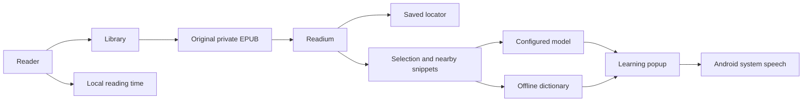

# Architecture

## Actors and flow

The reader imports an original EPUB into the local library, resumes a stable book location, and selects language for optional assistance. Readium presents the publication. The app supplies nearby selected-text context to the configured model, or queries the offline dictionary. Android TTS speaks selected text and complete examples. Local statistics aggregate actual reading activity.

## Ownership

- `model/`: stable application data contracts. Readium locator JSON stays opaque outside reader integration.
- `data/`: SQLite library and time records, settings and encrypted credentials, independently sourced dictionary.
- `reader/`: Readium opening/import/navigation, original EPUB file lifecycle, selection integration and reader controls.
- `learning/`: provider request/stream/structured response handling and the learning popup.
- `speech/`: TTS initialization, locale selection, playback ownership and cancellation.
- `ui/`: Focus app shell, library, statistics, settings and design tokens.
- `MarginApp`: dependency composition root; Android Activities own screen lifecycle.

## Technical decisions

Native Kotlin/Compose app shell with the established Readium Fragment navigator. The navigator is not a fork. Readium 3.1.0 is pinned for the available compileSdk 35/JDK 17 toolchain; upgrades require rerunning import, selection/context and saved-locator restoration acceptance. New alpha navigator APIs are not prerequisites. Dependency versions belong in Gradle, not in routing files.

Original EPUBs remain in app-private storage. SQLite persists library metadata, locator JSON and daily reading time. Settings are local; API credentials are encrypted with Android Keystore and excluded from backup. The UI observes repository state, not direct database queries.

Provider network access belongs to explicit model actions; publication content is local-only. Book reading, dictionary and installed offline voices do not depend on model availability. Android speech engines may use their own network voices after a pronunciation action when no matching offline voice is installed. Structured-output compatibility is isolated in the explanation client. Readium's selected-text snippets supply context; the explanation client alone owns the 30-word-per-side cap.

Last-book reopening is a cold-entry decision. Initial navigator construction uses the stored locator; persisted progress is never replaced by a guessed page index. Screen state and saved publication location are different lifetimes.

## Reader integration constraints

`reader/PublicationContentPolicy.kt` owns publication-content security. A public Readium container/resource transform serves sanitized HTML with a local-only Content Security Policy before Readium injects its trusted scripts. Original archives are unchanged. Authored executable content and automatic remote resources are excluded; explicitly activated external HTTP(S) links remain browser actions.

`reader/NavigationSafety.kt` owns decoded fragment validation across publication links, restored locations, search/TOC navigation and served internal links. The pinned navigator interpolates HTML IDs into native JavaScript, so unsafe string-literal characters must not reach that interface.

`reader/SelectionAnchor.kt` adapts the pinned navigator's selection rectangle: its top includes page padding but its bottom does not. Reassess this adapter when upgrading Readium; never apply a second density conversion to native pixel coordinates.

`reader/ResourceFailurePolicy.kt` distinguishes fatal HTML spine failures from optional image/font/stylesheet failures. An optional resource failure must not erase last-book recovery or close an otherwise readable book.

Preferences are field transformations applied inside the persistence lock, not stale whole-settings snapshots. API-key material is stored separately from the serialized settings model. Android cloud backup and device transfer exclude private app data.

Publication input bounds are owned by `EpubImporter`; they are checked against actual archive/resource bytes. Dictionary packaging uses a `.dict` extension to preserve precompressed gzip bytes through Android asset packaging; rebuilding is owned by `tools/build_dictionary.py`.

## Runtime constraints

JDK 17 is required by the pinned build. `gradlew` selects an installed JDK 17 on macOS when JAVA_HOME is absent; other hosts must provide JAVA_HOME or Java 17. Android SDK is resolved through ANDROID_HOME or ignored local.properties. Emulator/device and provider availability are verification prerequisites, not shared credentials. No host-specific paths belong here.

Android Fragment restoration must have a valid navigator factory before restoring fragments. Reader integration must handle process death without trusting restored transient pagination indices.
